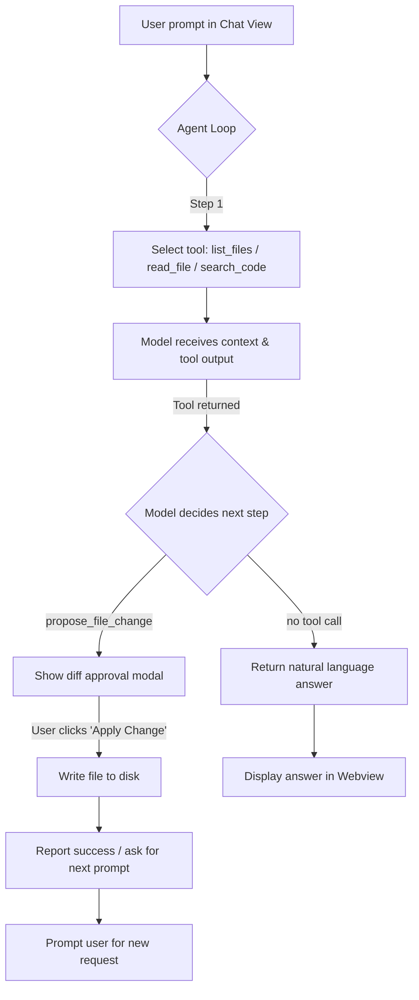

# FreePilot

[](https://opensource.org/licenses/MIT)
[](https://code.visualstudio.com/)
[](https://www.typescriptlang.org/)
[](https://openai.com/)
[](https://freellmapi.com/)

> An open-source, intelligent AI coding agent for VS Code that writes code, modifies files, and creates projects. Built on **FreeLLMAPI** and designed for VS Code extensions.

---

## 🤖 Key Features

| Feature | Description |
| :--- | :--- |
| **Code Writing** | Generate functions, classes, and entire files from natural language prompts. |
| **File Modification** | Propose targeted edits with diff previews; apply only after your approval. |
| **Project Creation** | Scaffold new projects with configured layouts, dependencies, and configs. |
| **Workspace Inspection** | List, read, and search files within the active workspace (respects `.gitignore`). |
| **Tool‑Calling Agent** | Multi‑step reasoning loop that can iterate up to `maxAgentSteps` calls. |
| **Secure API Key Storage** | Keys stored in VS Code `SecretStorage`; never committed to repo. |
| **Approval‑First Workflow** | Every file change requires an explicit “Review & Apply” confirmation. |
| **Webview Chat UI** | In‑VS Code chat interface with status, answers, and error reporting. |

---

## 🏗️ Architecture Flowchart



**TL;DR:** User types → Agent selects tool → Tool executes inside workspace → Model decides next action → Diff shown → You approve → File written → Agent loops or finishes.

---

## ⚙️ Local Setup

### Prerequisites

- [VS Code](https://code.visualstudio.com/) **1.85+**
- [Node.js](https://nodejs.org/) **20+**
- [FreeLLMAPI](https://freellmapi.com/) account with an **unified API key**

### 1️⃣ Clone & Install

```bash
git clone https://github.com/Vinoth-tnj/freepilot.git
cd freepilot
npm install
```

### 2️⃣ Configure FreeLLMAPI Key

Press **F5** to launch the Extension Development Host, or run:

```bash
code .
# Then open Command Palette (Cmd+Shift/P + Ctrl+Shift/P) and run
#   FreePilot: Configure
# Enter your FreeLLMAPI unified key when prompted.
```

*Alternatively, store the key programmatically in your **VS Code settings** (`settings.json`).*

### 3️⃣ Run & Test

- Press **F5** to start the Extension Development Host.
- The **FreePilot** icon appears in the Activity Bar.
- Open the **Agent Chat** panel and send a prompt like:
  > \"List the main project files and explain the architecture.\"

- The agent will list files, possibly read some, and answer.

### 4️⃣ Package as VSIX (for distribution)

```bash
npm install
npm run compile
npm install -g @vscode/vsce
vsce package
```

Install the generated `.vsix` via **Extensions: Install from VSIX...**

---

## 🛠️ Settings

All settings are defined under the **FreePilot** category in VS Code settings (`Preferences > Settings`). Add them to your `settings.json`:

| Setting | Type | Default | Description |
| :--- | :--- | :--- | :--- |
| `freepilot.baseUrl` | `string` | `""` | FreeLLMAPI OpenAI‑compatible base URL (leave empty for default). |
| `freepilot.model` | `string` | `"auto"` | Model or routing profile, e.g. `auto`, `gpt-4o`, `claude-3.5-sonnet`. |
| `freepilot.maxAgentSteps` | `number` | `8` | Maximum tool‑call iterations per request (1‑20). |
| `freepilot.apikey` | `string` | — | **Not a VS Code setting** — stored securely in VS Code SecretStorage via the *Configure* command. |

> **Tip:** After changing any setting, reload the extension (`Ctrl+Shift+P` → *Developer: Reload Window*) or restart the host.

---

## 🤝 Contribution Guide

We love contributions! Please follow these steps to help improve **FreePilot**:

1. **Fork** the repo and clone locally.  
2. **Create a branch** from `main`: `git checkout -b feature/short-description`.  
3. **Make your changes** — keep them minimal and focused. Add tests if applicable.  
4. **Test locally** with `npm run watch` (or press F5) to verify no regressions.  
5. **Commit** using conventional commits style (optional but appreciated):  
   ```bash
   git commit -m \"feat: add X functionality\"
   ```  
6. **Push** to your fork: `git push origin feature/short-description`.  
7. **Open a Pull Request** against the upstream `main` branch.  
   - Fill the PR template.  
   - Ensure all CI checks pass.  
   - Link any related issues (`Fixes #123`).  

### Development Workflow

| Step | Command |
| :--- | :--- |
| Install deps | `npm install` |
| Compile TS | `npm run compile` |
| Watch & auto‑compile | `npm run watch` |
| Package VSIX | `npm run package` |
| Lint / format | (none configured yet — add `eslint`/`prettier` as you like) |

---

## 📄 MIT License

```text
MIT License

Copyright (c) 2026 Vinoth_Kumar

Permission is hereby granted, free of charge, to any person obtaining a copy
of this software and associated documentation files (the \"Software\"), to deal
in the Software without restriction, including without limitation the rights
to use, copy, modify, merge, publish, distribute, sublicense, and/or sell
copies of the Software, and to permit persons to whom the Software is
furnished to do so, subject to the following conditions:

The above copyright notice and this permission notice shall be included in all
copies or substantial portions of the Software.

THE SOFTWARE IS PROVIDED \"AS IS\", WITHOUT WARRANTY OF ANY KIND, EXPRESS OR
IMPLIED, INCLUDING BUT NOT LIMITED TO THE WARRANTIES OF MERCHANTABILITY,
FITNESS FOR A PARTICULAR PURPOSE AND NONINFRINGEMENT. IN NO EVENT SHALL THE
AUTHORS OR COPYRIGHT HOLDERS BE LIABLE FOR ANY CLAIM, DAMAGES OR OTHER
LIABILITY, WHETHER IN AN ACTION OF CONTRACT, TORT OR OTHERWISE, ARISING FROM,
OUT OF OR IN CONNECTION WITH THE SOFTWARE OR THE USE OR OTHER DEALINGS IN THE
SOFTWARE.
```

---

## 🙋‍♂️ Quick Start (One‑Liner)

```bash
git clone https://github.com/Vinoth-tnj/freepilot.git
cd freepilot && npm install
# Open in VS Code, press F5, configure your FreeLLMAPI key, then chat!
```

---

## 📬 Contact & Community

- **GitHub:** [https://github.com/Vinoth-tnj/freepilot](https://github.com/Vinoth-tnj/freepilot)
- **Issues:** Use the [GitHub Issues](https://github.com/Vinoth-tnj/freepilot/issues) tracker.
- **Discussions:** Start a [Discussion](https://github.com/Vinoth-tnj/freepilot/discussions) for questions or ideas.
- **X / Twitter:** [@Vinoth-tnj](https://x.com/yourhandle) (optional)

Made with ❤️ for the open‑source community. Happy coding!